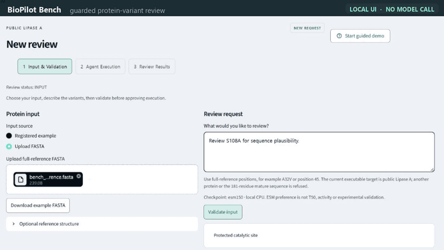

# BioPilot Bench

**From a protein-variant request to an inspectable scientific review.**

Upload a registered public Lipase A FASTA, describe a variant, and inspect the
result in one local workspace. Meta chooses permitted MCP tools and explains the
evidence; code enforces numbering, protected sites, approvals, budgets and ESM ranking.
The current product is a sequence evidence assistant, not a validated enzyme optimizer.

Documentation updated **2026-11-03** · Owner: **Yaeseong Park**.

## Demo



Fourteen seconds, silent, looping, and rendered inline on this page, so reading it
needs no Release download. A protected catalytic site is refused before any model
call. A permitted variant validates locally. The saved run is reopened to read its
ranked candidates and its reference structure, which reports that position 32 has no
atoms rather than inventing one. Anyone who can see this page already has repository
access, since the repository is private.

Every frame is a real capture of the running application. Camera movement,
highlighting and timing are editorial; no UI state, model reply or execution progress
is synthesised. [GIF receipt](submission/readme_gif_receipt.json).

### Full three-minute video

The 180-second cut adds English narration, measured captions and nine chapters over
the same captures. It is **not in this repository**: the binary does not belong in
source history, so it stays a Release attachment.

The attached asset is the **2026-11-02** cut. Its camera and emphasis were re-edited
on 2026-11-03, which removed a crossfade that double-exposed the UI text and dropped
the zooms that had no target. That re-encode is local and has not replaced the
attachment. The GIF above is from the re-edited version.

**[Demo Release — GitHub sign-in required](https://github.com/ParkYaeseong/BioPilot/releases/tag/demo-2026-11-02)**
· [English SRT](https://github.com/ParkYaeseong/BioPilot/releases/download/demo-2026-11-02/BioPilot_Bench_180s_EN.srt)
· [한국어 자막](https://github.com/ParkYaeseong/BioPilot/releases/download/demo-2026-11-02/BioPilot_Bench_180s_KO.srt)

The repository and its Release are **private**, so these are not anonymous
judge-access links: signed-out visitors get Not Found. Sign in as `ParkYaeseong` or
an account with repository access, then open **Assets**.

Local input checks run in the UI; the scientific execution is shown as **recorded
REPLAY** with waiting omitted. No new Meta or GPU inference happens during capture.
Full human listening review is still pending.
[Video guide and scope](demo/FINAL_VIDEO_20261102_KO.md)
· [Technical media receipt](submission/video_current_ui_20261102_receipt.json).

## Try the saved review and input checks

Prerequisites: Windows and Python 3.14. Use a new checkout/environment; do not replace
an existing working `.venv`. The following route installs the offline UI/intake only,
without model weights or the author's credentials.

```powershell
py -3.14 -m venv .venv
.venv/Scripts/python.exe -m pip install -r requirements-workbench-win-py314.lock.txt
.venv/Scripts/python.exe checks/check_reproduction.py
.venv/Scripts/python.exe -m streamlit run app/bench.py --server.headless true --server.address 127.0.0.1 --server.port 8522 -- --state-dir .runtime/judge-review --artifact demo/artifacts/unified_review_20261029.replay.json
```

Open http://127.0.0.1:8522/. The initial Overview contains 19 saved candidates.
Open **New review** to upload the public reference or try local validation.
`S108A` is refused; `A32V` passes validation. Without trusted model configuration,
execution remains disabled. Use `python -m streamlit` so the project can import `app`.

This route passed in a fresh isolated Windows/Python 3.14 environment and separate
source copy on the same PC. Another machine/OS and a fresh live inference installation
remain unverified. [Full reproduction instructions](submission/REPRODUCE_KO.md)
· [Reproduction receipt](validation/clean_workbench_reproduction_20261102.json).

## One workflow, inspectable results

1. **Input & Validation** — upload the registered full-reference FASTA and describe
   the review. Code rejects unsupported sequences, numbering and protected sites.
2. **Agent Execution** — inspect frozen input, checkpoint and call limits, then
   explicitly acknowledge permission and unverified cost before execution.
3. **Review Results** — inspect completion, failure or partial completion and reopen
   the saved result from Recent reviews without dispatching it again.

Results have unnumbered navigation: **Overview / Candidates / Structure / Agent Trace / Evidence**.
Candidates and Structure share the inspected candidate. A request such as A32V
validates the requested substitution, then reviews all 19 non-WT alternatives at that
approved position under one common ranking policy. Optional annotations do not rerank it.

New Review has a five-step local guide; saved results have a nine-step guide.
Both guides operate the real interface and cannot grant execution permission.
[Unified workflow guide](docs/UNIFIED_WORKBENCH_KO.md).

## What Meta actually does

| Component | Responsibility |
|---|---|
| Meta `muse-spark-1.3` | Select permitted tools and provide a bounded evidence explanation |
| BioPilot MCP server and Python core | Enforce reference identity, coordinates, constraints, approval and budget guards |
| Pinned ESM-2 150M on local CPU | Compute full-reference sequence preference scores |
| Deterministic ranking and viewer | Rank candidates by one policy and render stored numerical artifacts |

The current recorded uploaded-input run completed in **45.48 seconds**, using
**3 Meta requests**, **2 MCP calls** (`validate_target_context`, `score_positions`)
and **19 candidates** in the registered `full_212` context. Its actual provider bill
is unknown; a local request reservation is not an invoice or currency ceiling.
This single run does not establish workflow time savings or biological gain.

- [Current actual execution receipt](validation/unified_review_execution_20261029.json)
- [Portable replay with original report/score provenance](demo/artifacts/unified_review_20261029.replay.json)
- [Actual Meta runtime evidence](compliance/META_RUNTIME_EVIDENCE.md)
- [Earlier integration receipt](validation/integration_success_20261027.json) — historical execution, separate from the 45.48 s run

Fresh execution additionally requires the documented Meta/MCP/science dependencies,
your own credentials, pinned local ESM weights and explicit approval. The shipped
demo does not include owner keys or automatically download models. See
[execution setup](docs/IMPLEMENTATION_KO.md) and [current workflow](docs/UNIFIED_WORKBENCH_KO.md).

## Structure and additional recorded evidence

- The interactive reference viewer uses pinned public 1ISP data and a locally checked
  full-reference/deposited-sequence/observed-residue join. A32 has no modeled atoms;
  no location is invented. S108 maps to author 77. Index correspondence does not
  establish atom geometry, stability, activity or binding changes.
- ESM3 A32V and ESMFold2 WT have separately recorded L40S executions. They are stored
  predictions, distinct from the experimental WT reference and the baseline Meta run.
  [Optional GPU receipt](validation/optional_science_runtime_20261028.json).
- Atlas provides a sanitized pinned exact-WT snapshot, not a fresh search on page view.
  Automatic remote folding, RunPod, deployed Modal and native Muse Code hosting
  remain disabled or unverified. [Optional science guide](docs/OPTIONAL_SCIENCE_KO.md).

## Scientific scope and checks

Executable inputs currently cover only the registered public Lipase A full 212-residue sequence,
not arbitrary proteins or the 181-residue mature sequence. Use full-reference 1-based
coordinates; interactive review protects S108/D164/H187. Protection does not guarantee
retained function. ESM scores are dimensionless sequence preferences, not T50, Tm,
activity, solubility or experimental validation.

The retrospective evaluation does not establish useful T50 prediction: its site-bootstrap
interval includes zero. [Biological readiness](docs/12_biological_readiness.md)
· [Evaluator summary](validation/site_bootstrap_summary.json).
Evaluator labels, outcomes and result-bearing papers stay outside the prediction-agent
workspace, MCP catalog and GPU worker. Do not mount this whole repository into the agent;
use the reviewed allowlisted runtime bundle.

With the documented development dependencies installed:

```powershell
.venv/Scripts/python.exe -m pytest tests tests_app -q -rs -p no:cacheprovider
.venv/Scripts/python.exe checks/validate_package.py
```

Actual test commands and scopes are recorded in [STATUS](docs/STATUS.md).
Fixtures, replay and live integrations are identified separately.

## What belongs in Git, Releases and local storage

| Location | Contents |
|---|---|
| Git source history | Application/tests, dependency pins, setup guides, small approved public reference/prediction artifacts, sanitized receipts and preview images |
| Release assets | MP4, measured English/Korean SRTs and SHA256SUMS; download separately from source |
| Local only | Keys and `.env`, runtime databases, model weights, caches, raw captures/audio, reference GIF and evaluation imports |

This keeps the video out of source history. The original source package dates and
development history are preserved. [Release upload receipt](submission/demo_release_20261102.json).

## Development, access and submission status

The project began as a v3 design/prompt package dated 2026-10-27, with preserved v2
helpers and planning provenance. Do not present reused preparation as newly authored
event work. [Development history](compliance/DEVELOPMENT_HISTORY.md)
· [Reuse ledger](compliance/originality_ledger.csv)
· [Codex/Claude development disclosure](compliance/AI_DEVELOPMENT.md).

Source and demo assets are currently private. Public/judge access, final form/rules,
contributor/rights confirmation, prior-work eligibility and a submission receipt remain
open. Video upload does not mean the project has been submitted.
[Submission draft](submission/README.md)
· [Rules check and remaining questions](compliance/HACKATHON_READINESS_KO.md).

## Licensing

A project-wide license has not been assigned. Bundled third-party material retains
its own terms and notices. [Attribution and rights status](compliance/THIRD_PARTY_NOTICES.md).
