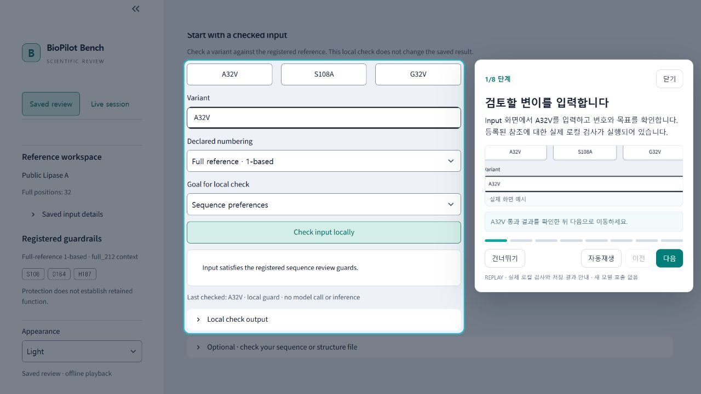

# BioPilot Bench v3 | Guarded protein-variant review through MCP

**Publication snapshot: 2026-10-29. Owner: Yaeseong Park.**

A controlled Meta host calls BioPilot MCP tools to review single substitutions of a public
Lipase A reference. Code enforces numbering, protected sites, budgets and one common ESM ranking
policy. The product is an **unvalidated sequence evidence assistant**. It does not predict calibrated
T50, activity, solubility or Tm, or establish retained function.

## What actually runs

- A real saved execution completed Meta → MCP validation → local ESM scoring → a no-tool Meta
  explanation in one run. The requested and returned model was `muse-spark-1.3`; the negotiated
  MCP protocol was `2025-11-25`.
- That execution recomputed ESM-2 150M on CPU, using pinned weights/tokenizer and the registered
  `full_212` context. Code ranked 19 alternatives at full-reference position 32 using
  `esm150_masked_v1`. Receipt: [integration_success_20261027.json](validation/integration_success_20261027.json).
- A local read-only Streamlit viewer renders saved artifacts. Opening a saved execution is
  **REPLAY**; it does not call Meta or recompute ESM. See [the demo guide](demo/README_KO.md).
- Local stdio MCP, persistent run/budget controls, constrained model tool calls and guarded
  failure paths have offline tests. Test results are recorded in [STATUS](docs/STATUS.md).
- ESM3 A32V and ESMFold2 WT have actual, separately recorded L40S executions with verified
  full-reference output sequences. The viewer displays the stored predictions alongside
  the experimental reference, with their provenance and limits. [GPU evidence](validation/optional_science_runtime_20261028.json).
- A real exact-WT Atlas response is available as a sanitized, pinned MCP snapshot. This
  bounded tool does not make a live search or automatically fold a missing result.

The recorded integration took 40 seconds and three Meta requests. Its actual provider bill is
**unknown**; the local reservation is not a verified charge. This single run does not measure
workflow time savings. Automatic remote folding through the product MCP, RunPod, deployed Modal
and native Muse Code hosting remain disabled or unverified. Separate approved worker executions
are distinguished from the historical Meta trace.

## Review workspace

The workbench has readable light/dark controls, ordered input and file diagnostics, candidate
comparison, reference/predicted structures, recorded-event navigation and an eight-step spotlight
tutorial with actual screen examples. The linked live session starts unarmed.
See [the workspace guide](docs/WORKSPACE_REFINEMENT_KO.md), [optional science guide](docs/OPTIONAL_SCIENCE_KO.md)
and [three-minute recording guide](demo/RECORD_SPOTLIGHT_KO.md).
Actual saved scientific output remains REPLAY; no new model call is made by viewing.



## Meta use, authorship and development evidence

- [Actual Meta runtime evidence](compliance/META_RUNTIME_EVIDENCE.md): provider/model, permitted calls and source artifacts.
- [AI-assisted development disclosure](compliance/AI_DEVELOPMENT.md): Codex/Claude roles, verification and what is shared.
- [Development history](compliance/DEVELOPMENT_HISTORY.md) and [reuse ledger](compliance/originality_ledger.csv): earlier preparation and new contributions, with original commits preserved.
- [Current rules check](compliance/HACKATHON_READINESS_KO.md): verified guide requirements and remaining form/reuse questions.

Private assistant conversations, keys, runtime databases, model weights and raw video/capture
directories are excluded. The code, small reference/prediction artifacts, test records and hashes
are sufficient to inspect the implemented flow. Current-date publication commits do not pretend
to be earlier development commits.

## Start locally

Use the existing project environment from PowerShell:

```powershell
.venv/Scripts/python.exe -m app.cli validate --variant A32V
.venv/Scripts/python.exe -m app.cli validate --variant S108A
.venv/Scripts/python.exe -m pytest tests tests_app -q -rs -p no:cacheprovider
.venv/Scripts/python.exe checks/validate_package.py
```

`S108A` must be blocked because it changes a protected site. These commands do not send provider
requests. For local MCP workspace creation, saved-run viewing and separately gated inference, read
[the Korean execution guide](docs/IMPLEMENTATION_KO.md). The installed environment is Windows,
Python 3.14.0, MCP 1.25.0, PyTorch 2.9.1, Transformers 5.2.0 and Streamlit 1.66.1. A clean installation
on another machine has not been verified; pinned requirement files record the installed versions.

## Evidence and submission scope

[The submission draft](submission/README.md) maps implemented behavior to saved evidence and
remaining gates. A local 180-second edited replay video draft with disclosed synthetic English voice and captions
is available through the submission draft. Human review, public/judge-access verification and a
submission receipt remain pending. The intended track/theme remain Indie Developer / Push the Frontier, subject to the final
rules, eligibility and prior-work ruling. [The captured rules](compliance/rules_snapshot.json) are a
historical snapshot, not a newly verified final rulebook.

An evaluator-only retrospective subset has a complete-case Spearman of 0.288 with a 95% site-bootstrap
interval of [-0.058, 0.536], spanning zero, over 117 measured variants at nine sites. It does not
establish useful T50 prediction or general performance. See [the evaluator summary](validation/site_bootstrap_summary.json)
and [biological readiness](docs/12_biological_readiness.md). Evaluator outputs never belong in a
prediction-agent workspace or MCP catalog.

## Boundaries and provenance

Inputs use full-reference 1-based coordinates, the `full_212` scoring context and interactive
protection of S108/D164/H187. Sequence correspondence is not verified PDB atom geometry; unknown
coordinates stay null. Optional evidence cannot silently rerank the common baseline.

Do not connect the prediction agent to this whole repository. Build the allowlisted runtime workspace;
exclude labels, evaluator outputs, outcome-bearing papers and generic shell/file/URL tools. New live
provider calls, downloads, GPU work, sequence uploads, publication, deployment and submission require
their corresponding explicit approval.

The project began as a v3 design/prompt package dated 2026-10-27, replacing v2. Its original statement
that it contained only plans and guard examples describes that source package, before the local
implementation. The original package manifest and the [originality ledger](compliance/originality_ledger.csv)
preserve this history. Neither earlier design/helpers nor dependencies may be presented as newly
authored event work. See [the original implementation plan](docs/superpowers/plans/2026-10-27-v3-mcp-hackathon.md)
and [the decision log](docs/DECISIONS.md).

## Licensing

A project-wide license has not been assigned. Bundled third-party material has its own terms
and retained notices; see [attribution and rights status](compliance/THIRD_PARTY_NOTICES.md).
