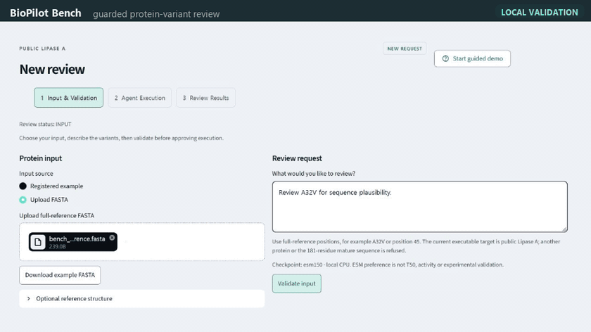
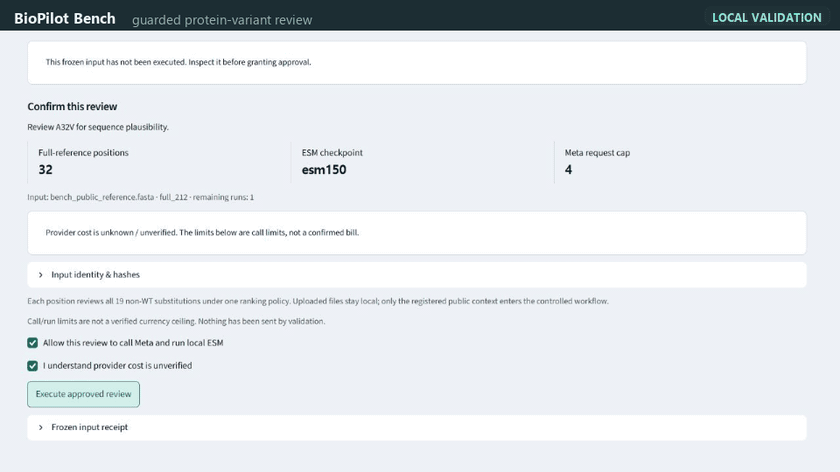
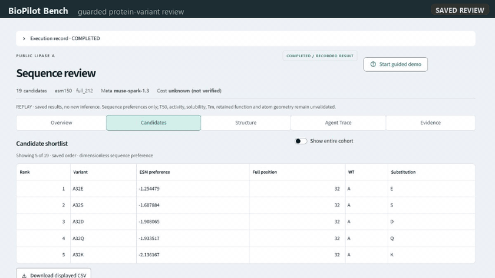
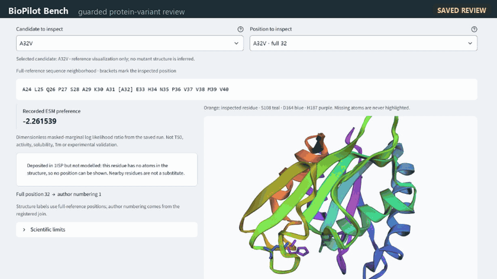
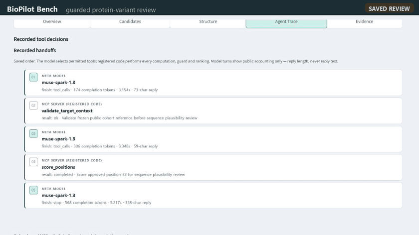

# BioPilot Bench

**From a protein-variant request to an inspectable scientific review.**

BioPilot Bench brings file validation, Meta-directed scientific tools and candidate
review into one local workspace. Meta selects permitted MCP tools and explains the
evidence; code enforces scientific constraints, execution limits and ranking.

[Demo](#demo) · [Features](#features) · [Quickstart](#quickstart) · [Event contributions](compliance/EVENT_CONTRIBUTIONS.md) · [MIT License](LICENSE)

## Demo

Upload a public Lipase A FASTA, approve a review, then inspect candidates, structure and evidence.

**[Watch the three-minute demo on YouTube](https://www.youtube.com/watch?v=V7jWi7q1ggU)**

## Features

Short walkthroughs from real recorded application screens, with edited zoom and highlights.

### Validate input before running

Upload the registered public FASTA and check reference identity, numbering and
protected sites. `S108A` is refused locally; `A32V` passes validation.



### Approve and execute a bounded review

Check permissions and call limits before execution. The recorded run follows
Meta → MCP → local ESM and reaches a saved completed result.



### Compare candidate variants

Inspect 19 alternatives under one ranking policy, compare the top three and
select a candidate for closer review.



### Inspect the reference structure

Locate residues using checked reference-to-structure correspondence and rotate the
public 3D reference. Positions without observed atoms remain unmarked.



### Follow the evidence

Inspect Meta's actual tool requests, the recorded scoring arguments and the
input/report hashes behind the saved review.



## Quickstart

Windows · Python 3.14. From a fresh checkout:

```powershell
py -3.14 -m venv .venv
.venv/Scripts/python.exe -m pip install -r requirements/workbench-win-py314.lock.txt
.venv/Scripts/python.exe -m streamlit run app/bench.py --server.address 127.0.0.1 --server.port 8522 -- --state-dir .runtime/judge-review --artifact demo/artifacts/unified_review_20261029.replay.json
```

Open **http://127.0.0.1:8522/** to explore saved results or start **New review**.
Try `A32V` for a valid input or `S108A` to see the catalytic-site guard.

Saved results and input checks run offline. New execution requires your own Meta
credentials, pinned local ESM weights and explicit approval.
[Installation and reproduction](submission/REPRODUCE_KO.md) · [Execution setup](docs/IMPLEMENTATION_KO.md)

## Workflow

**Input & Validation → Agent Execution → Review Results**

Results are organized into **Overview / Candidates / Structure / Agent Trace / Evidence**.
Candidates and Structure share the inspected candidate. Reopening a saved review
reads its recorded results without starting another model call.

| Component | Role |
|---|---|
| Meta `muse-spark-1.3` | Select permitted tools and explain evidence |
| MCP server and Python core | Enforce guards, approvals and execution budgets |
| Local ESM-2 150M | Compute sequence preferences |
| Review workbench | Compare candidates and inspect structure, trace and provenance |

## Scope

The executable target is currently the registered public Lipase A full 212-residue
reference. ESM scores are sequence preferences, not experimental T50, activity,
stability or proof of retained function. Structure views distinguish the reference
from stored predictions and leave missing atom coordinates unmarked.

## Development and contributions

Built for the Meta Global AI Developer Hackathon by **Yaeseong Park**, with substantial
Codex and Claude development assistance. Event work includes the guarded Meta/MCP
workflow, unified workbench, evidence views and guided onboarding. Existing planning,
helper algorithms, public models, data and libraries are disclosed separately.

[Contribution breakdown](compliance/EVENT_CONTRIBUTIONS.md)
· [Development history](compliance/DEVELOPMENT_HISTORY.md)
· [AI assistance](compliance/AI_DEVELOPMENT.md)
· [Execution and validation records](docs/STATUS.md)

## License

Original project code and documentation: **[MIT](LICENSE)**.
Third-party components, models and data retain their own terms.
[Third-party notices](compliance/THIRD_PARTY_NOTICES.md).
