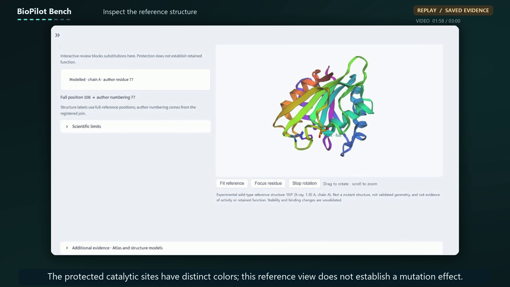

# 현재 UI로 제작한 3분 시연 영상

2026-11-02 제작본을 **2026-11-03 실제 실행 흐름으로 재편집**했습니다.
로컬의 같은 MP4 경로에 저장하며, 직전 편집본은
`local_artifacts/final_demo_20261102/before_execution_edit_20261103/`에 보존합니다.
빠른 확대 후 고정, 정확한 둥근 강조 박스와 주변 디밍 스타일을 유지합니다.
첫 챕터에는 행사 중 구현한 MCP 검토·워크벤치임을 표시하고,
[새 기능과 재사용 구분](../compliance/EVENT_CONTRIBUTIONS.md)을 README·제출 문서에 연결했습니다.
이 자막 표기 수정은 새 Meta/GPU 호출 없이 재인코딩했으며 Release에도 교체했습니다.

최종 영상: **[YouTube에서 보기](https://www.youtube.com/watch?v=V7jWi7q1ggU)**.
사용자가 업로드한 주소를 대표 링크로 사용합니다. YouTube 재생 길이·공개 범위·자막 트랙은
이 갱신에서 독립적으로 검증하지 않았습니다. 기존 GitHub Release는 사용자 요청으로 삭제했으며,
원본 영상·한영 자막·설명·썸네일은 로컬에 보존합니다.
[원본 제작 기록](../submission/video_current_ui_20261102_receipt.json)과
[실제 실행 기록](../validation/video_quality_recapture_20261103.json)은 계속 보존합니다.
과거 Release 업로드·접근 기록은 당시의 검증 이력이며 현재 다운로드 안내가 아닙니다.



로컬 결과 위치:

```text
local_artifacts/final_demo_20261102/BioPilot_Bench_180s_EN.mp4
local_artifacts/final_demo_20261102/BioPilot_Bench_180s_EN.srt
local_artifacts/final_demo_20261102/BioPilot_Bench_180s_KO.srt
```

## 구성

- 실제 길이 180초, 1920×1080, 30fps, H.264/AAC, 챕터 9개입니다.
- 영어 내레이션은 본인 녹음이 아닌 `en-US-AndrewNeural` 합성 음성입니다.
  공개 대본만 Microsoft Edge 온라인 음성 서비스로 생성했습니다. 제품의 Meta 모델과
  내레이션 생성 도구는 별개이며 비공개 대화·인증정보·단백질 파일을 음성 서비스에 보내지 않았습니다.
- 영어 자막을 화면에 넣고, 영어/한국어 SRT를 별도로 제공합니다. 플레이어가 자막을
  자동으로 이중 표시하지 않도록 MP4의 선택 자막 트랙은 넣지 않았습니다.
  27개 문장의 시간은 실제 음성 생성 메타데이터와 편집된 오디오에서 계산했습니다.
  과거 `REVIEW_FLOWS_180S_*.srt`는 촬영 전 계획이며 이 영상의 실측 자막은 위 새 파일입니다.
- 카메라는 각 숏에서 빠른 확대를 한 번 수행한 뒤 완전히 고정합니다. 느린 표류형 확대는
  쓰지 않습니다. 확대 배율은 강조 대상에서 역산하므로 강조 박스가 화면 밖으로 잘리지
  않으며, 대상이 화면 전체 폭이면 자연히 확대하지 않습니다. 강조는 둥근 테두리와 광채,
  주변 디밍으로 표시하고 카메라가 멈춘 뒤에 나타납니다. 같은 스크린샷을 다시 잡는 전환은
  디졸브하지 않습니다. 이전 편집본은 이때 UI 글자가 겹쳐 보이는 잔상이 있었습니다.
  [AionUi 참고 GIF](https://github.com/iOfficeAI/AionUi/blob/main/resources/AionUi_team.gif)는
  편집 스타일 참고용으로 확인했으며 영상에 삽입하지 않았습니다.
- README용 14초 무음 반복 GIF를 같은 캡처에서 따로 만듭니다
  (`docs/images/biopilot-demo.gif`, 760×428, 약 2.4MB,
  [영수증](../submission/readme_gif_receipt.json)). 새 촬영이나 새 실행은 없습니다.

## 보여 주는 실제 동작

| 시간 | 화면과 확인할 점 |
|---|---|
| 0–15초 | 행사 중 만든 MCP 검토·워크벤치라고 표시하고 New Review에서 시작 |
| 15–35초 | 실제 공개 FASTA 업로드와 S108A의 로컬 보호 규칙 거부 |
| 35–55초 | A32V 검증, 위치32·esm150·호출 상한4·실행 허용 및 비용 확인 |
| 55–75초 | 활성 Execute 버튼 → 실제 RUNNING → COMPLETED → 새 결과; 대기 단축 표시 |
| 75–100초 | 저장된 후보 순위, 상위3개 비교, A32V 선택 |
| 100–125초 | A32 원자 없음, S108→author77 대응, 실제 기준 구조 회전 |
| 125–145초 | 이번 실행의 실제 Meta/MCP 검증·점수 요청과 인수·출력 |
| 145–165초 | 업로드 입력 영수증, 보고서 해시, 공개 구조 잔기 대응 |
| 165–180초 | COMPLETED 기록 재열기, 근거 검토와 생물학적 한계 |

실제 브라우저 화면을 CUA로 샘플링해 편집했습니다. 연속 OS 스크린캐스트는 아닙니다.
확대·강조·화면 타이밍은 편집 효과이며, UI 상태·모델 답변·실행 진행률을 합성하지 않았습니다.
구조 회전은 실제 뷰어에서 촬영한 프레임입니다. 원자 위치가 없는 A32에 가짜 마커를
넣지 않았고, 구조 화면은 실험 기준 WT 시각화이며 새 변이체 예측이 아닙니다.

## 실제 실행과 재생의 구분

45–68초의 승인·실행 화면은 이전 내장 브라우저 캡처 원본부터 흐릿했습니다.
사용자 확인 후 **추가 실행 1회(최대 Meta 요청4회·로컬 CPU·GPU 없음)**를 승인받아
별도 촬영 한도1회로 재촬영했습니다. Chrome의 실제 선명한 원본으로 바꾸었으며
AI 업스케일이나 UI 합성은 하지 않았습니다. 빠른 확대와 둥근 박스 스타일은 유지합니다.

현재 영상에 보이는 실행은 검토 ID `093ed33a29154e76a0d43fdf52a8267b`, run `1a614cadfe604b36999ad33c316f2dfd`입니다.
실제 모델 `muse-spark-1.3`가 Meta 요청3회로 MCP 검증·로컬 CPU ESM-2 150M 점수를
실행해 후보19개를 생성했습니다. 이 촬영 배치 한도는0→1회 사용했으며, 기존 주 작업
기록 사용량3회는3회로 그대로입니다. 기존 기록·이력을 지우거나 허용량을 초기화하지 않았습니다.

입력 장면의 공개 FASTA와 **같은 바이트**를 새로 업로드·검증하여 실행했습니다.
입력 장면은 이전 촬영 자료를 유지하므로 끊김 없는 단일 녹화는 아니며 대기는 편집으로 줄였습니다.
새 실행과 이전 실행의 후보19개 및 점수 파일 목록이 정확히 같음을 확인해 후보·공개 기준 구조
장면은 유지했습니다. 승인·RUNNING·완료·Meta trace·입력/보고서 영수증·재열기는 이번 실행을 촬영했습니다.

11월3일 영상 제작의 두 실행을 합치면 Meta 요청은총6회이며, 현재 재촬영 실행은 그중3회입니다.
GPU 호출과 추가 음성 생성은 이번 화질 수정에 없습니다. 영상 상단에서 실행 중과 결과 재생을 구분합니다.

완료 뒤 결과 탐색은 **REPLAY**이며 모델 재호출이 없습니다. 실행 중 상태와 저장 결과 탐색을
영상 상단에서 구분합니다. ESM 점수는 실험적 내열성·활성·기능 유지의 검증값이 아닙니다.

## 게시 전 최종 확인

전체 파일 디코딩, 음성 존재·음량, 실측 자막 타임스탬프, 24개 인코딩 프레임과 원본
캡처 해시를 검사했습니다. 사람이 전체 음성을 듣고 최종 싱크를 확인한 상태는 아직
아닙니다. 최종 시청과 공식 폼의 조건·공개 링크 접근을 확인한 뒤 게시/제출합니다.

영상 설명에 사용할 영어 문구:

> AI-generated English narration over actual application captures. Camera movement,
> highlights and timing are edited. The same frozen public upload is shown from
> input through an actual approved Meta/MCP/local CPU ESM execution, with waiting
> shortened. Result inspection is replay. Three Meta requests; no GPU call.
